<p align="center">
  
</p>

<p align="center">
  <a href="https://github.com/ishandutta2007/Awesome-Awesome-Awesome"></a>
  <a href="https://discord.gg/jc4xtF58Ve"></a>
  <a href="https://github.com/ishandutta2007/Awesome-No-Code-Agent-Deployment-Workspaces/stargazers"></a>
  <a href="https://github.com/ishandutta2007/Awesome-No-Code-Agent-Deployment-Workspaces/network/members"></a>
  <a href="https://github.com/ishandutta2007/Awesome-No-Code-Agent-Deployment-Workspaces/blob/main/LICENSE"></a>
  <a href="https://github.com/ishandutta2007/Awesome-No-Code-Agent-Deployment-Workspaces/pulls"></a>
  <a href="https://github.com/ishandutta2007"></a>
</p>

---

# 🤖 Awesome No-Code Agent Deployment Workspaces

> A curated directory and architectural taxonomy of leading **No-Code AI Agent Deployment Workspaces**, **Visual Workflow Builders**, and **Self-Hostable Agentic Runtimes**. Discover tools that empower operations, marketing, sales, and platform teams to build, orchestrate, test, and deploy autonomous LLM agents and multi-agent systems via drag-and-drop canvases without writing code.

---

## 📑 Table of Contents

- [📊 Sector Overview & Market Dynamics](#-sector-overview--market-dynamics)
- [🏢 SaaS & Hosted Agent Workspaces](#-saas--hosted-agent-workspaces)
  - [SaaS Platforms Comparison Table](#saas-platforms-comparison-table)
  - [Detailed SaaS Profiles](#detailed-saas-profiles)
- [🔓 Open-Source Agent Workspaces & Runtimes](#-open-source-agent-workspaces--runtimes)
  - [Open-Source Ecosystem Leaderboard](#open-source-ecosystem-leaderboard)
  - [Detailed Open-Source Profiles](#detailed-open-source-profiles)
- [🧩 Architectural Taxonomy & Core Components](#-architectural-taxonomy--core-components)
- [🤝 How to Contribute](#-how-to-contribute)
- [📈 Star History](#-star-history)
- [💖 Support & Community](#-support--community)
- [⚖️ Disclaimer & Security Governance](#-disclaimer--security-governance)

---

## 📊 Sector Overview & Market Dynamics

The global **AI Agent & Autonomous Workflow Orchestration market** is experiencing exponential expansion, valued between **$7.8 Billion and $8.3 Billion in 2025** and projected to surge to **$11.5 Billion to $12.1 Billion in 2026**, on track to eclipse **$50 Billion+ by 2030** at a Compound Annual Growth Rate (CAGR) of **43% to 49%**.

Currently, the market exhibits a **moderately fragmented structure** rather than a winner-take-all monopoly. While established enterprise automation incumbents (such as Zapier and Celonis/Make) leverage extensive catalogs of 1,000+ pre-built SaaS connectors, a surge of specialized visual AI orchestrators (including Dify, Langflow, Relevance AI, and Flowise) are rapidly capturing market share. This fragmentation is propelled by enterprise demands for **data sovereignty**, **local/self-hosted deployment**, **Model Context Protocol (MCP)** tool integration, and transparent execution graphs that eliminate unpredictable per-token markups.

```
┌─────────────────────────────────────────────────────────────────────────────┐
│                      AGENT ORCHESTRATION SPECTRUM                           │
├──────────────────────────────┬──────────────────────────────────────────────┤
│  ⚡ Legacy Automation Giants │  🎨 Visual AI-Native Canvases                │
│  (Zapier, Make.com)          │  (Dify, Langflow, Flowise, Sim Studio)       │
│  • Rule-based + AI triggers  │  • Graph-based node editors, ReactFlow       │
│  • Deep SaaS app catalogs    │  • Native RAG, vector embeddings & memory    │
├──────────────────────────────┼──────────────────────────────────────────────┤
│  🤖 Vertical Autonomous Bots │  🔓 Self-Hosted Open Runtimes                │
│  (Lindy, Relevance AI, Dust) │  (n8n, Activepieces, Open-WebUI, Rivet)      │
│  • Pre-tuned departmental AI │  • Full code escape hatches (Python/JS)      │
│  • Email/Slack/Voice triage  │  • Native MCP servers & zero-markup hosting  │
└──────────────────────────────┴──────────────────────────────────────────────┘
```

---

## 🏢 SaaS & Hosted Agent Workspaces

SaaS platforms offer turn-key, managed infrastructure with built-in multi-tenant collaboration, managed model routing (OpenAI, Anthropic, Gemini, Mistral, Llama), enterprise single sign-on (SSO), and out-of-the-box governance.

### SaaS Platforms Comparison Table

*Sorted in descending order by company scale (Valuation / Revenue).*

| Platform | Company Scale (Valuation / Revenue) | Starting Paid Tier Pricing | Free Tier / Trial Limit | Deployment Focus & Primary Canvas Strengths |
| :--- | :--- | :--- | :--- | :--- |
| **[Make.com](https://www.make.com/)** | **$13.0B Valuation** *(Parent: Celonis; ~$50M+ ARR)* | **$9.00 / mo** *(Core Plan: 10,000 operations/mo)* | **Free Forever**: 1,000 ops/mo, 2 active scenarios, 15-min sync intervals, 100 MB data transfer | Drag-and-drop visual scenario builder, 1,800+ integrations, OpenAI/Anthropic native workflow modules |
| **[Zapier Central](https://zapier.com/central)** | **$5.0B Valuation** *(~$250M+ ARR)* | **$19.99 / mo** *(Starter Plan: 750 tasks/mo, billed annually)* | **Free Forever**: 100 tasks/mo, 5 single-step Zaps; 400 Central bot runs/mo during preview | Natural-language agent canvas with instant bi-directional actions across 6,000+ business applications |
| **[Rivet (Ironclad)](https://rivet.ironcladapp.com/)** | **$3.2B Valuation** *(Ironclad; ~$100M+ ARR)* | **$0 Local / $500.00 / mo** *(Ironclad Cloud Enterprise)* | **Free Forever**: Unlimited local visual graphs & debugging via open-source desktop app; 30-day enterprise POC | Node-based graph programming environment, step-through real-time execution debugger, TypeScript runtime |
| **[Relevance AI](https://relevanceai.com/)** | **$150M Valuation** *(Raised $37M; Series B led by Bessemer)* | **$29.00 / mo** *(Pro Plan: 2,500 actions/mo, 2 build seats)* | **14-day Free Trial**: 100 bonus test actions, full multi-agent workforce orchestration & tool builder | Invent 2.0 process mapper, autonomous B2B specialist agents (BDR, sales triage, research, customer support) |
| **[Dify Cloud](https://dify.ai/)** | **$80M Valuation** *(Raised $15M+ Series A)* | **$59.00 / mo** *(Professional: 5,000 credits/mo, 50 apps, 3 seats)* | **Free Forever (Sandbox)**: 200 system credits (unlimited BYOK), 5 apps, 50 docs / 50 MB RAG storage, 5,000 API calls/mo | Visual LLM workflow builder, RAG knowledge retrieval pipeline, Chatflow engine, and agent plugin registry |
| **[Stack AI](https://www.stack-ai.com/)** | **$80M Valuation** *(Raised $19.6M; Series A led by Lobby)* | **$199.00 / mo** *(Team Plan: 10,000+ workflow runs/mo, multi-user seats)* | **Free Forever**: 500 workflow runs/mo, 2 active projects, 1 seat, community Discord support | Enterprise visual flow builder, live vector search connectors, SOC 2/HIPAA guardrails, zero data retention |
| **[Dust](https://dust.tt/)** | **$80M Valuation** *(Raised $16M; Series A led by Sequoia)* | **$29.00 / user / mo** *(Pro Plan: unlimited assistant creation)* | **15-day Free Trial**: 500 test messages, full Notion/Slack/Drive knowledge syncing, custom assistant builder | Collaborative workspace agents, company-wide knowledge base synchronization, multi-model side-by-side switcher |
| **[Lindy AI](https://www.lindy.ai/)** | **$60M Valuation** *(Raised $13M; backed by Menlo & Coatue)* | **$29.99 / user / mo** *(Plus Plan: 3,000 credits/mo, automated triage)* | **7-day Free Trial**: Pooled task credits, full access to connected tools (Email, Calendar, Slack); no card upfront | Autonomous digital employee builder, omni-channel triggers (SMS, iMessage, Slack), computer-use actions |
| **[MindStudio](https://www.mindstudio.ai/)** | **$30M Valuation** *(YouAi; Raised $6M Seed)* | **$20.00 / mo** *(Starter Plan: unlimited platform runs & agents)* | **Free Forever**: 1 active deployed agent, 1,000 runs/mo, unlimited personal drafts, 200+ models via Service Router | No-code AI builder, 500+ actions in MindStudio Connector Registry (MSCR), full VM code sandbox, debugger AI |

---

### Detailed SaaS Profiles

#### 1. [Make.com](https://www.make.com/)
- **Overview**: Leading visual integration and workflow automation canvas owned by Celonis. Empowers teams to design multi-branch logic, error handlers, and loops linking AI inference nodes with enterprise software.
- **Starting Price**: `$9.00/month` (billed annually for Core tier) or `$10.59/month` (monthly).
- **Free Tier**: Free Forever with 1,000 operations/month, 2 active scenarios, and 15-minute execution intervals.
- **Best For**: Operations and marketing teams requiring intricate data transformations combined with LLM text generation and classification.

#### 2. [Zapier Central](https://zapier.com/central)
- **Overview**: An experimental yet powerful natural-language agent workspace from Zapier. Users configure autonomous bots that monitor real-time data feeds, execute multi-step automations across 6,000+ apps, and report outcomes into Slack or email.
- **Starting Price**: `$19.99/month` (billed annually for Starter plan with 750 tasks).
- **Free Tier**: Free Forever with 100 tasks/month; Central beta includes 400 free bot runs/month.
- **Best For**: Non-technical team leads who want immediate bot execution without manually wiring JSON webhooks.

#### 3. [Rivet](https://rivet.ironcladapp.com/)
- **Overview**: Developed by legal-tech unicorn Ironclad, Rivet is an advanced node-based visual programming environment and TypeScript runtime created specifically for architecting, evaluating, and debugging complex agent logic.
- **Starting Price**: `$0` (Free and open-source desktop software); Ironclad enterprise cloud integration starts from `$500.00/month`.
- **Free Tier**: Free Forever for unlimited local graph execution, debugging, and mock testing.
- **Best For**: Prompt engineers, platform builders, and product teams needing granular control over graph execution state.

#### 4. [Relevance AI](https://relevanceai.com/)
- **Overview**: B2B agent workforce platform with **Invent 2.0** that interviews operators, analyzes documentation, maps corporate processes, and assembles coordinated teams of specialist AI agents (BDRs, customer support reps, research analysts).
- **Starting Price**: `$29.00/month` (Pro tier with 2,500 actions/mo and vendor credits).
- **Free Tier**: 14-day free trial with 100 complimentary test actions and full access to workforce orchestration.
- **Best For**: Revenue operations, sales development, and automated customer success workflows.

#### 5. [Dify Cloud](https://dify.ai/)
- **Overview**: Hosted edition of the popular Dify platform. Features an intuitive visual workflow editor combining multi-model inference, vector databases for RAG, prompt engineering sandboxes, and web-app publishing.
- **Starting Price**: `$59.00/month` (Professional tier with 5,000 message credits, 50 apps, 3 team members).
- **Free Tier**: Free Forever Sandbox tier with 200 system credits (BYOK allowed once depleted), 5 apps, 50 docs / 50 MB knowledge storage.
- **Best For**: Fast-growing startups and product teams needing a complete AI backend without server maintenance.

#### 6. [Stack AI](https://www.stack-ai.com/)
- **Overview**: Enterprise-grade no-code platform for deploying internal assistants, document intelligence pipelines, and back-office agents. Emphasizes enterprise security compliance (SOC 2 Type II, HIPAA, GDPR, VPC isolation).
- **Starting Price**: `$199.00/month` (Team tier with 10,000+ runs/month and team workspace).
- **Free Tier**: Free Forever plan with 500 workflow runs/month, 2 projects, 1 seat, and community support.
- **Best For**: Regulated industries (financial services, healthcare, legal) deploying secure document analysis agents.

#### 7. [Dust](https://dust.tt/)
- **Overview**: Enterprise assistant platform backed by Sequoia Capital. Continuously synchronizes with Notion, Google Drive, Slack, and GitHub to power departmental AI assistants that reference authoritative internal company knowledge.
- **Starting Price**: `$29.00/user/month` (Pro tier with unlimited assistants and team data connections).
- **Free Tier**: 15-day free trial with 500 test queries and full knowledge base connectivity.
- **Best For**: Internal knowledge sharing, company-wide executive assistants, and research teams.

#### 8. [Lindy AI](https://www.lindy.ai/)
- **Overview**: Autonomous digital employee workspace designed to handle calendar management, email triage, CRM lead qualification, and customer support. Accessible through web, Slack, iMessage, and SMS.
- **Starting Price**: `$29.99/user/month` (Plus tier with 3,000 monthly credits).
- **Free Tier**: 7-day free trial with pooled workspace task credits (no credit card required).
- **Best For**: Solopreneurs, executives, and agile agencies delegating repetitive daily administrative workflows.

#### 9. [MindStudio](https://www.mindstudio.ai/)
- **Overview**: Visual development workspace from YouAi equipped with 500+ actions in the open-source MindStudio Connector Registry (MSCR), full VM execution for custom functions, and an intelligent debugger AI built into run logs.
- **Starting Price**: `$20.00/month` (Starter tier with unlimited agents and platform executions; tokens billed at-cost).
- **Free Tier**: Free Forever with 1 active agent, 1,000 runs/month, unlimited personal drafts, and 200+ models.
- **Best For**: Creative technologists and no-code builders developing public or monetized custom AI applications.

---

## 🔓 Open-Source Agent Workspaces & Runtimes

Open-source projects offer self-hosting, custom node development, air-gapped security, zero per-run fees, and direct integration with open-weights models (Ollama, vLLM, LM Studio) and standard protocols like **Model Context Protocol (MCP)**.

### Open-Source Ecosystem Leaderboard

*Ranked strictly in descending order by GitHub Stars. Badges link directly to each repository's stargazers page.*

| Rank | Repository | Star Count Badge | Primary Focus & Architecture | License | Docker Self-Host |
| :---: | :--- | :---: | :--- | :--- | :---: |
| 1 | **[n8n](https://github.com/n8n-io/n8n)** | [](https://github.com/n8n-io/n8n/stargazers) | Fair-code visual node workflow automation with 70+ native AI/LLM nodes & 400+ SaaS connectors | Sustainable Use (Fair-code) | `docker run -it --rm --name n8n -p 5678:5678 n8nio/n8n` |
| 2 | **[Dify](https://github.com/langgenius/dify)** | [](https://github.com/langgenius/dify/stargazers) | Full-stack LLM application platform: visual workflow canvas, multi-agent orchestrator & RAG engine | Modified Apache 2.0 | `docker compose up -d` |
| 3 | **[Langflow](https://github.com/langflow-ai/langflow)** | [](https://github.com/langflow-ai/langflow/stargazers) | Visual Python framework for building multi-agent workflows, ReactFlow canvas & MCP server exporter | Apache 2.0 | `docker run -p 7860:7860 langflowai/langflow:latest` |
| 4 | **[Open WebUI](https://github.com/open-webui/open-webui)** | [](https://github.com/open-webui/open-webui/stargazers) | Extensible, self-hosted AI interface with custom agent pipelines, Ollama integration & RAG tools | MIT | `docker run -d -p 3000:8080 -v open-webui:/app/backend/data ghcr.io/open-webui/open-webui:main` |
| 5 | **[RAGFlow](https://github.com/infiniflow/ragflow)** | [](https://github.com/infiniflow/ragflow/stargazers) | Deep-document RAG engine fusing visual document parsing, knowledge graphs & autonomous agent workflows | Apache 2.0 | `docker compose up -d` |
| 6 | **[OpenHands](https://github.com/All-Hands-AI/OpenHands)** | [](https://github.com/All-Hands-AI/OpenHands/stargazers) | Autonomous software engineering agent workspace capable of modifying code, running bash & web browsing | MIT | `docker run -it --pull=always -u root -p 3000:3000 ghcr.io/all-hands-ai/openhands:main` |
| 7 | **[Flowise](https://github.com/FlowiseAI/Flowise)** | [](https://github.com/FlowiseAI/Flowise/stargazers) | Drag-and-drop UI for LangChain & LlamaIndex components, multi-agent supervisor graphs & chat embeds | Apache 2.0 | `docker run -d -p 3000:3000 flowiseai/flowise` |
| 8 | **[LibreChat](https://github.com/LibreChat-AI/LibreChat)** | [](https://github.com/LibreChat-AI/LibreChat/stargazers) | Enterprise-grade multi-model chat workspace with Agents, MCP support, Code Interpreter & multi-user auth | MIT | `docker compose up -d` |
| 9 | **[CopilotKit](https://github.com/CopilotKit/CopilotKit)** | [](https://github.com/CopilotKit/CopilotKit/stargazers) | The frontend & canvas stack for building in-app AI copilots, generative UI, and agent interactions | MIT | `npm install @copilotkit/react-core` |
| 10 | **[AgentGPT](https://github.com/reworkd/AgentGPT)** | [](https://github.com/reworkd/AgentGPT/stargazers) | Assemble, configure, and deploy autonomous goal-driven AI agents directly within the browser | GPL-3.0 | `docker compose up` |
| 11 | **[Sim Studio](https://github.com/simstudioai/sim)** | [](https://github.com/simstudioai/sim/stargazers) | "Figma for AI Agents" — collaborative visual workspace for designing, testing, and deploying multi-agent flows | PolyForm Shield / Apache 2.0 | `docker compose up -d` |
| 12 | **[Activepieces](https://github.com/activepieces/activepieces)** | [](https://github.com/activepieces/activepieces/stargazers) | MIT-licensed workflow automation where every piece (~400 tools) is exposed as an MCP server for agents | MIT | `docker compose up -d` |
| 13 | **[Rivet](https://github.com/Ironclad/rivet)** | [](https://github.com/Ironclad/rivet/stargazers) | Visual graph editor & debugger for AI agent workflows with full TypeScript runtime execution | MIT | Desktop installer / `npm install @ironclad/rivet-node` |
| 14 | **[OpenRigor](https://github.com/wangyunjeff/OpenRigor)** | [](https://github.com/wangyunjeff/OpenRigor/stargazers) | Clean-room persistent agent workspace with sandboxed tools, durable runs, replayable SSE & artifacts | MIT | `npm run dev` |

---

### Detailed Open-Source Profiles

#### 1. [n8n](https://github.com/n8n-io/n8n) [](https://github.com/n8n-io/n8n/stargazers)
- **Architecture**: Node.js & TypeScript backend with a highly responsive visual node editor. Combines 400+ enterprise integrations with ~70 specialized AI/LLM nodes (LangChain memory, vector store loaders, tool nodes, and multi-agent loops).
- **License**: Sustainable Use License (Fair-code, free for internal company use).
- **Key Features**: Human-in-the-loop approval triggers, inline custom JavaScript/Python execution, sub-workflow routing, and webhooks.
- **Best For**: Advanced automation engineers seeking an enterprise-wide integration hub coupled with agentic execution.

#### 2. [Dify](https://github.com/langgenius/dify) [](https://github.com/langgenius/dify/stargazers)
- **Architecture**: Python (Flask/Celery) + Next.js frontend with PostgreSQL and Redis. Supports five distinct application types: Chatbot, Agent, Text Generator, Chatflow, and Workflow.
- **License**: Modified Apache 2.0 (commercial SaaS restrictions apply).
- **Key Features**: Rich visual workflow canvas, built-in RAG ingestion pipeline with chunking and hybrid reranking, prompt engineering sandbox, and a plugin marketplace.
- **Best For**: Teams needing a turnkey, self-hostable alternative to proprietary LLM cloud backends.

#### 3. [Langflow](https://github.com/langflow-ai/langflow) [](https://github.com/langflow-ai/langflow/stargazers)
- **Architecture**: Python backend utilizing ReactFlow on the frontend. Every visual block directly translates into executable Python code with full component customization.
- **License**: Apache 2.0.
- **Key Features**: Interactive step-by-step playground, export flows as standalone APIs or Model Context Protocol (MCP) servers, seamless observability with LangSmith and Langfuse.
- **Best For**: Python developers wanting rapid drag-and-drop prototyping while retaining direct code access.

#### 4. [Open WebUI](https://github.com/open-webui/open-webui) [](https://github.com/open-webui/open-webui/stargazers)
- **Architecture**: FastAPI backend + SvelteKit frontend. Supports full offline local inference via Ollama as well as remote OpenAI-compatible endpoints.
- **License**: MIT.
- **Key Features**: Modular Pipelines framework for building agentic actions, web search integration, multi-user role-based access control, and document RAG.
- **Best For**: Organizations establishing a private, internal ChatGPT-style workplace assistant with custom tools.

#### 5. [RAGFlow](https://github.com/infiniflow/ragflow) [](https://github.com/infiniflow/ragflow/stargazers)
- **Architecture**: Deep document understanding engine combined with agent orchestration, built on Python and Elasticsearch/Infinity.
- **License**: Apache 2.0.
- **Key Features**: Visual document template extraction (extracting complex tables, diagrams, and unstructured layouts from PDFs), fused with visual agent conversation flows.
- **Best For**: Document-heavy enterprise workflows requiring zero hallucination in financial, legal, and engineering documentation.

#### 6. [OpenHands](https://github.com/All-Hands-AI/OpenHands) [](https://github.com/All-Hands-AI/OpenHands/stargazers)
- **Architecture**: Python-based autonomous agent framework paired with sandboxed Docker execution environments and interactive web GUI.
- **License**: MIT.
- **Key Features**: Autonomous code generation, terminal execution, browser navigation, git branch modification, and PR creation.
- **Best For**: Engineering teams building automated software maintenance agents, code review bots, and bug-fixing pipelines.

#### 7. [Flowise](https://github.com/FlowiseAI/Flowise) [](https://github.com/FlowiseAI/Flowise/stargazers)
- **Architecture**: Node.js & TypeScript framework wrapping LangChain and LlamaIndex into a modular drag-and-drop canvas.
- **License**: Apache 2.0.
- **Key Features**: Multi-agent supervisor configurations, chat embedding widgets for customer websites, custom tool building, and vector store connectors.
- **Best For**: Fast visual prototyping of conversational agents, RAG search engines, and web-embeddable bots.

#### 8. [LibreChat](https://github.com/LibreChat-AI/LibreChat) [](https://github.com/LibreChat-AI/LibreChat/stargazers)
- **Architecture**: Node.js + React. Unified chat frontend supporting multiple LLM providers (Anthropic, OpenAI, Gemini, DeepSeek, Ollama, OpenRouter).
- **License**: MIT.
- **Key Features**: Multi-agent workflows, Model Context Protocol (MCP) tool integration, Code Interpreter, Artifacts, and multi-tenant authentication (OAuth/SAML).
- **Best For**: Teams seeking a unified, feature-packed enterprise web interface for multiple AI agent roles.

#### 9. [CopilotKit](https://github.com/CopilotKit/CopilotKit) [](https://github.com/CopilotKit/CopilotKit/stargazers)
- **Architecture**: React/TypeScript frontend UI library and SDK powering in-app copilots, interactive canvas workspaces, and agent-driven user interfaces.
- **License**: MIT.
- **Key Features**: AG-UI Protocol, context-aware sidebar copilots, generative UI components, and bi-directional application state synchronization.
- **Best For**: Frontend engineers integrating custom AI agent assistants directly into existing web applications.

#### 10. [AgentGPT](https://github.com/reworkd/AgentGPT) [](https://github.com/reworkd/AgentGPT/stargazers)
- **Architecture**: Next.js + TypeScript web application for autonomous goal-seeking agents.
- **License**: GPL-3.0.
- **Key Features**: Visual objective breakdown, recursive agent task execution, memory retention, and web search integration.
- **Best For**: Experimenting with recursive autonomous task planners in a zero-setup browser interface.

#### 11. [Sim Studio](https://github.com/simstudioai/sim) [](https://github.com/simstudioai/sim/stargazers)
- **Architecture**: Next.js + ReactFlow + PostgreSQL (pgvector). Designed as a collaborative "Figma for AI Agents".
- **License**: PolyForm Shield 1.0.0 / Apache 2.0.
- **Key Features**: Real-time collaborative canvas, natural language Copilot that creates and repairs nodes, webhook triggers, and HIPAA/SOC2 compliance.
- **Best For**: Cross-functional product and engineering teams collaboratively designing complex agent graphs.

#### 12. [Activepieces](https://github.com/activepieces/activepieces) [](https://github.com/activepieces/activepieces/stargazers)
- **Architecture**: Modern TypeScript monorepo with an intuitive visual automation canvas.
- **License**: MIT.
- **Key Features**: Over 280+ community pieces ("apps"), with every integration automatically exposed as an MCP server for agents (Claude Desktop, Cursor, Windsurf).
- **Best For**: Developers prioritizing 100% OSI-approved open source and AI-native MCP tool calling.

#### 13. [Rivet](https://github.com/Ironclad/rivet) [](https://github.com/Ironclad/rivet/stargazers)
- **Architecture**: Electron desktop application + Node.js/TypeScript graph runtime.
- **License**: MIT.
- **Key Features**: Visual graph debugging, step-by-step state inspection, execution replay, and embedding graphs inside backend microservices.
- **Best For**: Platform engineers requiring deterministic, inspectable graph runtimes with zero external cloud lock-in.

#### 14. [OpenRigor](https://github.com/wangyunjeff/OpenRigor) [](https://github.com/wangyunjeff/OpenRigor/stargazers)
- **Architecture**: Clean-room persistent AI workspace built with modern web technologies and real Codex app-server execution.
- **License**: MIT.
- **Key Features**: Durable runs that survive client disconnects, sandboxed tool runs, replayable SSE event streams, and inspectable artifact delivery.
- **Best For**: Developers researching durable, stateful AI agent execution architectures.

---

## 🧩 Architectural Taxonomy & Core Components

Every modern no-code agent deployment workspace relies on four fundamental layers:

```
┌─────────────────────────────────────────────────────────────────────────────┐
│ 1. VISUAL ORCHESTRATION CANVAS                                              │
│    Drag-and-Drop Nodes • Subgraph Routing • Human-in-the-Loop Interventions │
├─────────────────────────────────────────────────────────────────────────────┤
│ 2. MODEL ROUTER & REASONING RUNTIME                                         │
│    Model Switcher (GPT-5, Sonnet 3.7, Gemini 2.5 Flash, Ollama) • Guardrails│
├─────────────────────────────────────────────────────────────────────────────┤
│ 3. CONTEXT & KNOWLEDGE RETRIEVAL (RAG)                                      │
│    Vector Databases • Chunking Strategies • Semantic Cache • Hybrid Search  │
├─────────────────────────────────────────────────────────────────────────────┤
│ 4. TOOL INTEGRATION & PROTOCOL LAYER                                        │
│    Model Context Protocol (MCP) • Webhooks • OpenAPI Specs • Sandbox VMs    │
└─────────────────────────────────────────────────────────────────────────────┘
```

1. **Visual Orchestration Canvas**: Graph-based node editors (typically built with ReactFlow) providing visual control over execution flow, conditional branching, loops, and fallback pathways.
2. **Model Router & Reasoning Runtime**: Multi-provider abstractions allowing users to switch models dynamically based on latency, cost, and reasoning depth requirements without breaking downstream nodes.
3. **Context & RAG Engine**: Native ingestion pipelines that process PDFs, web pages, and documents into embeddings stored in Milvus, Qdrant, Chroma, or pgvector for semantic retrieval.
4. **Tool & Protocol Integration (MCP)**: Support for Anthropic's **Model Context Protocol (MCP)**, REST APIs, and native connectors allowing agents to take real-world actions in CRMs, databases, and issue trackers.

---

## 🤝 How to Contribute

Contributions are warmly welcomed! Help keep this ecosystem guide up-to-date by submitting pull requests:

1. 🍴 **Fork the repository** on GitHub.
2. 🌿 **Create a descriptive feature branch** (`git checkout -b add-my-agent-platform`).
3. 📝 **Add your entry** following the established format:
   - Platform name and official URL.
   - For SaaS: Company scale (valuation/revenue), exact starting pricing, exact free tier limit, and core canvas features.
   - For Open-Source: GitHub repo link, star count badge, license, and architectural description.
4. ✅ **Ensure accuracy**: Verify that all pricing, free tier limits, and links are up to date.
5. 🚀 **Submit a Pull Request** with a concise summary of the changes.

*See also: Curated awesome collections on [Awesome-Awesome-Awesome](https://github.com/ishandutta2007/Awesome-Awesome-Awesome).*

---

## 📈 Star History

[](https://star-history.dera.page/#ishandutta2007/Awesome-No-Code-Agent-Deployment-Workspaces&type=date&legend=top-left)

---

## 💖 Support & Community

Thank you for exploring and bookmarking **Awesome No-Code Agent Deployment Workspaces**! 🌟

If this curated ecosystem helps you navigate the AI agent landscape:
- ⭐ **Star this repository** to support our research and help others discover it!
- 🍴 **Fork it** and contribute your favorite frameworks, tools, or updates via a Pull Request.
- 📢 **Share it** with your colleagues, platform engineers, and AI adoption leads on LinkedIn, Twitter/X, and Reddit.
- ☕ **Sponsor the Project**: If this resource saves your team time, consider supporting ongoing maintenance and updates through our [GitHub Sponsors Dashboard](https://github.com/sponsors/ishandutta2007). Every contribution is deeply appreciated!

---

## ⚖️ Disclaimer & Security Governance

- **Community-Curated**: This list is maintained for educational and informational purposes. Inclusion does not imply official commercial endorsement.
- **Compliance & Security**: AI agent deployment workspaces must comply with data protection regulations (**GDPR**, **CCPA**), industry frameworks (**SOC 2 Type II**, **HIPAA**), and company data governance rules. Visual canvases can occasionally obscure complex data paths—always audit what data each agent node reads and where API payloads are transmitted.
- **Licensing Vigilance**: Open-source license terms vary significantly. Always review specific license obligations before commercial redistribution.

---

<p align="center">
  <b>Built with ❤️ for AI engineers, platform teams, automation architects, and no-code builders worldwide.</b>
</p>
